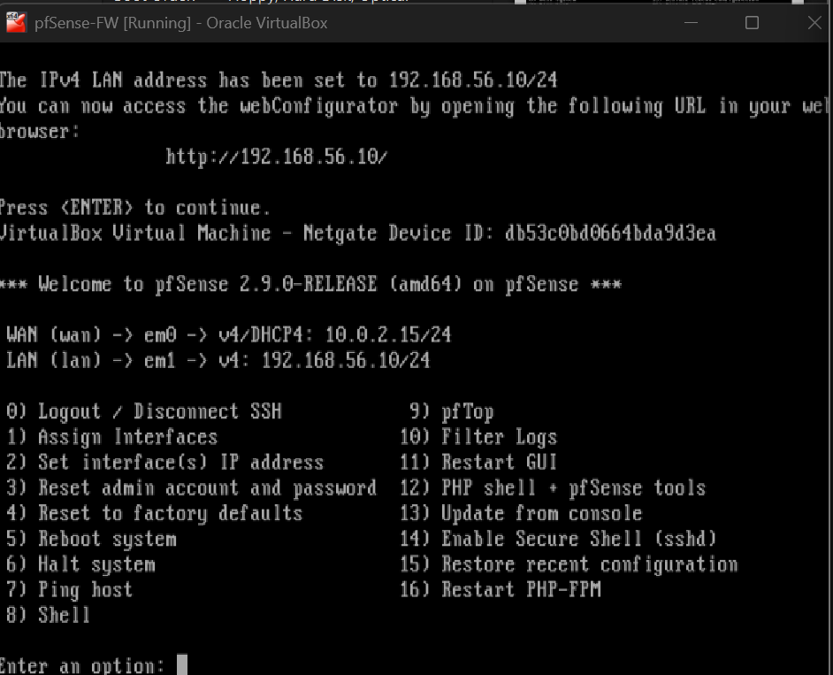
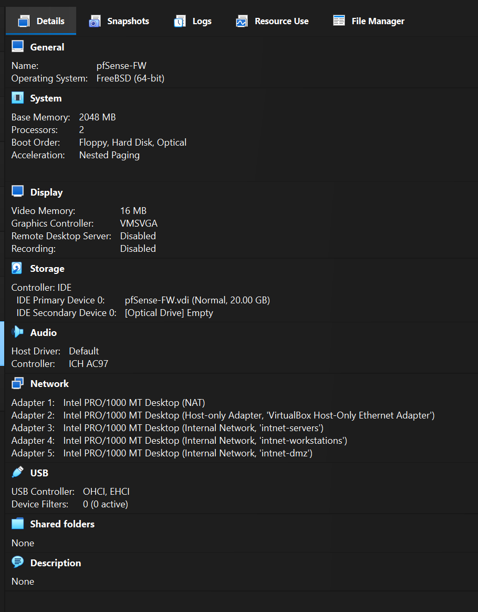
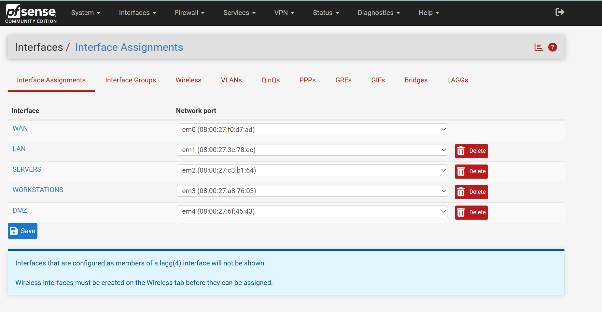
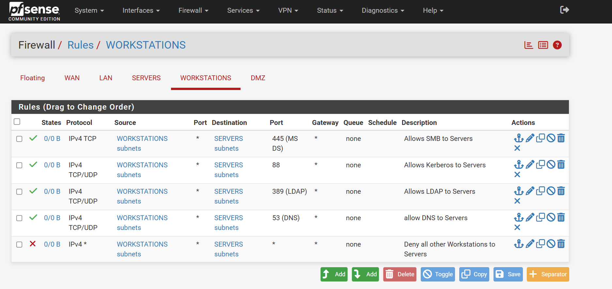
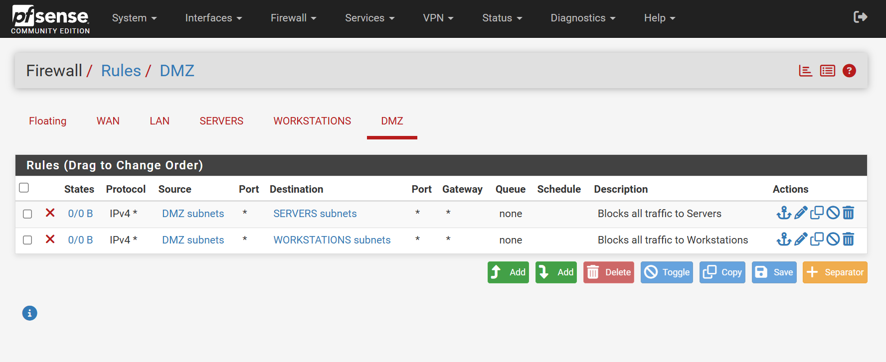

# Phase 1 — Network Segmentation (pfSense)

## What I Built

pfSense-FW running as the virtual router/firewall between all segments, with 5 network adapters:

- Adapter 1: NAT (WAN / internet uplink)
- Adapter 2: Internal Network — `intnet-mgmt`
- Adapter 3: Internal Network — `intnet-servers`
- Adapter 4: Internal Network — `intnet-workstations`
- Adapter 5: Internal Network — `intnet-dmz`

VirtualBox only exposes 4 network adapters per VM in the GUI by default, so the 5th adapter (DMZ) had to be added from the command line:

```
vboxmanage modifyvm "pfSense-FW" --nic5 intnet --intnet5 intnet-dmz
```


*pfSense CE installer console — first boot after attaching the ISO.*


*pfSense-FW VM specs, including the 5th DMZ adapter added via the command line.*

## Interface Assignments

pfSense enumerates interfaces starting at 0, so the 5 total adapters are labeled `em0`–`em4`:

| Interface | Role | Adapter |
|---|---|---|
| em0 | WAN | NAT (internet uplink) |
| em1 | MGMT | Internal Network (`intnet-mgmt`) |
| em2 | SERVERS | Internal Network (`intnet-servers`) |
| em3 | WORKSTATIONS | Internal Network (`intnet-workstations`) |
| em4 | DMZ | Internal Network (`intnet-dmz`) |


*Web GUI view of the interface assignments, confirming all 5 adapters map correctly.*

## Static IP Assignments

DHCP stays enabled on each internal interface, but each segment also got a static gateway IP:

| Segment | Subnet |
|---|---|
| MGMT | 10.10.10.0/24 |
| SERVERS | 10.10.20.0/24 |
| WORKSTATIONS | 10.10.30.0/24 |
| DMZ | 10.10.40.0/24 |

IPv6 DHCP isn't needed for this lab — pfSense enables it by default, and it can be toggled off per interface when statically assigning IPs.

## Firewall Rules

Default posture is deny-all between segments, with narrow pass rules opened where required:

- **WORKSTATIONS → SERVERS**: blocked by default, with explicit allow rules above the deny for DNS (53), Kerberos (88), LDAP (389), and SMB (445) — the ports a domain-joined client actually needs to talk to the DC.
- **DMZ → SERVERS / WORKSTATIONS**: fully blocked, no exceptions yet. This gets narrowed later to intentionally open a single path for the Phase 6 pen-test exercise.


*WORKSTATIONS → SERVERS: least-privilege rule set — one of the most important screenshots in the build, since it's direct evidence of segmentation design.*


*DMZ is fully isolated from both internal segments by default — the baseline posture before a path is opened for the pen-test exercise.*

## Next Steps

- Test segmentation with ping sweeps between segments (blocked paths fail, allowed ports succeed).
- Open a narrow DMZ → WORKSTATIONS (or target) rule later, specifically for the Phase 6 pen-test exercise.
