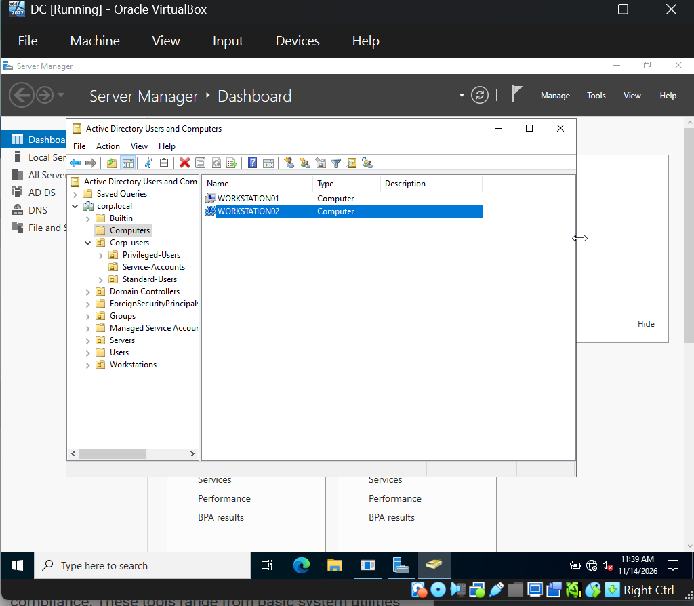
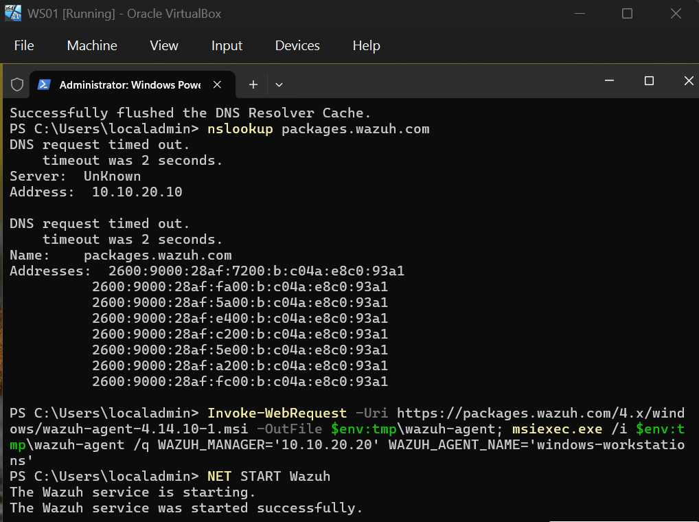
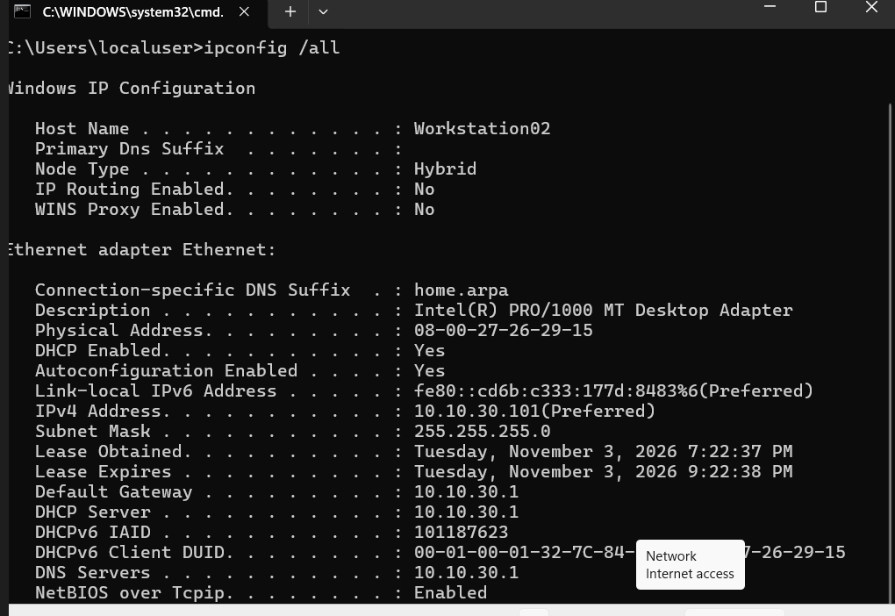
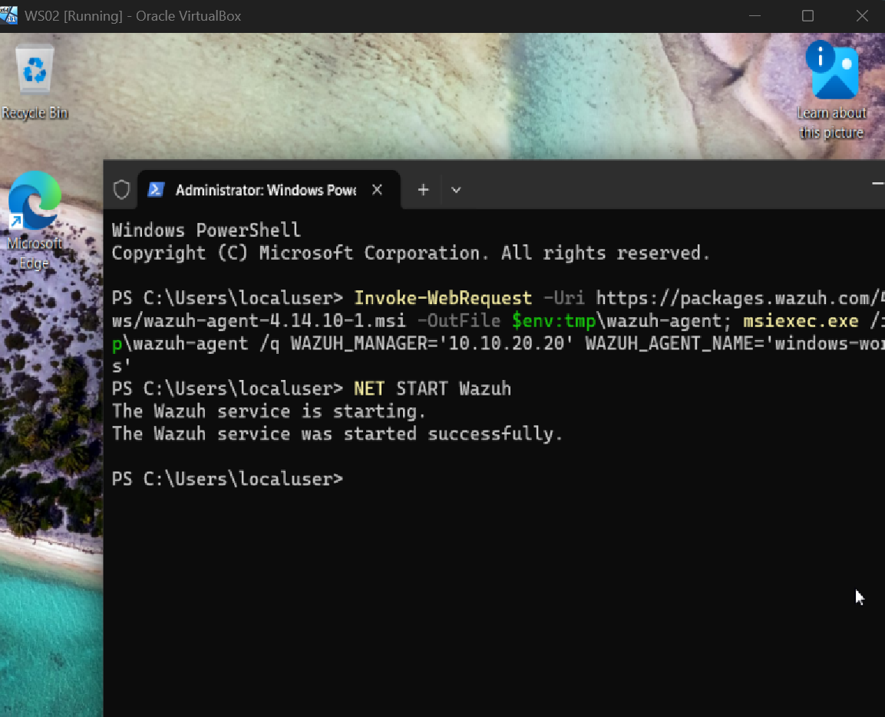

# Phase 3 — Client Workstations

## What I Built

Two Windows 11 Pro clients, **WS01** and **WS02**, built in VirtualBox on the
`intnet-workstations` network and joined to the `corp.local` domain. They pull
addressing from pfSense on the WORKSTATIONS segment (`10.10.30.0/24`) and are the
endpoints that generate realistic authentication and process telemetry for the SIEM.

| Host | OS | IP | Domain | Role |
|------|----|----|--------|------|
| WS01 | Windows 11 Pro | `10.10.30.100` | `corp.local` | Domain-joined client |
| WS02 | Windows 11 Pro | `10.10.30.101` | `corp.local` | Domain-joined client |

### Domain join

Both machines were joined to `corp.local` and appear as computer objects under the
domain. From the DC, the Active Directory Users and Computers console shows
`WORKSTATION01` and `WORKSTATION02` registered in the domain:

*Both workstations successfully joined to `corp.local` and visible from the domain controller.*

### Connectivity check

Before enrolling agents, each workstation was verified for routing to the SERVERS
segment (DC on `10.10.20.10`, SIEM on `10.10.20.20`) through pfSense:

*WS01 — connectivity to the internal segments confirmed through the pfSense WORKSTATIONS interface.*

*WS02 — same check, confirming least-privilege firewall rules still permit the required AD/SIEM paths.*

### Wazuh agent enrollment

Each workstation runs the Wazuh agent, registered to the manager on `10.10.20.20`.
Full install detail is in [Phase 4](04-siem-wazuh.md#agent-enrollment); the agent
installs and starts cleanly on the client side:

*WS02 — Wazuh agent service running and reporting to the manager.*

## Status / Next Steps

- [x] WS01 and WS02 built and domain-joined to `corp.local`.
- [x] Connectivity through pfSense verified.
- [x] Wazuh agent installed on both; both show **Active** on the dashboard (see [Phase 4](04-siem-wazuh.md)).
- [x] Sysmon (SwiftOnSecurity config) deployment — planned via GPO in [Phase 7](07-automation.md).
- [x] Generate realistic logon noise (interactive logons across the tiered user accounts) ahead of the Phase 6 exercise.
