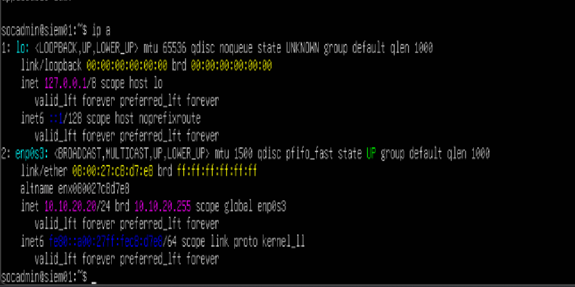
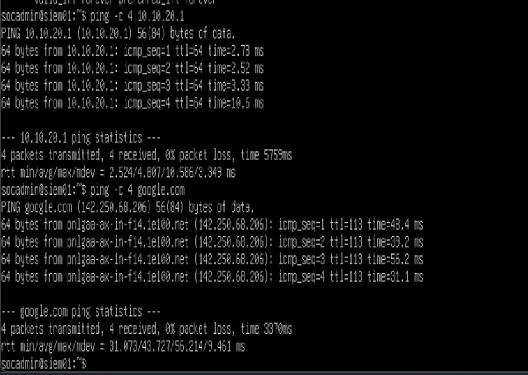
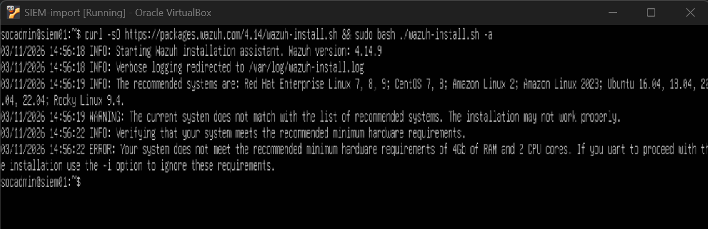
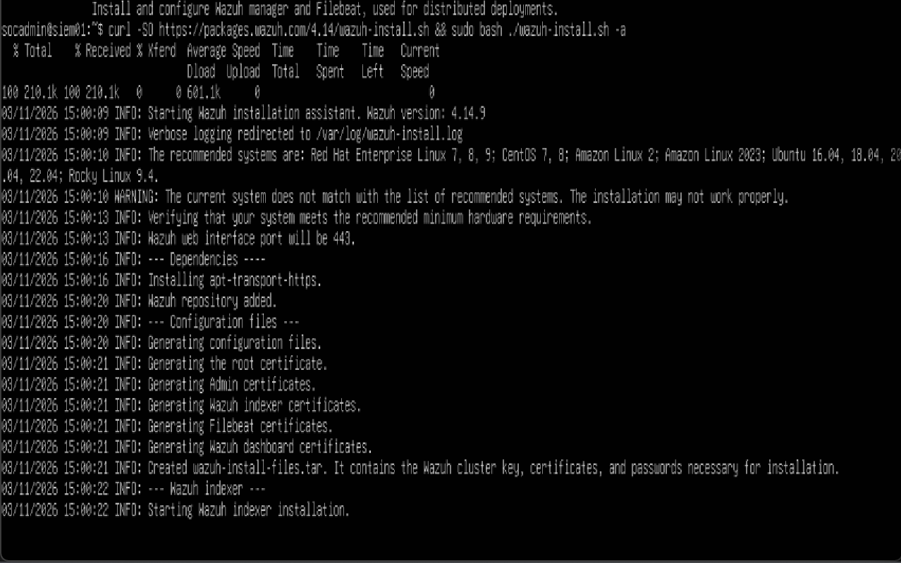
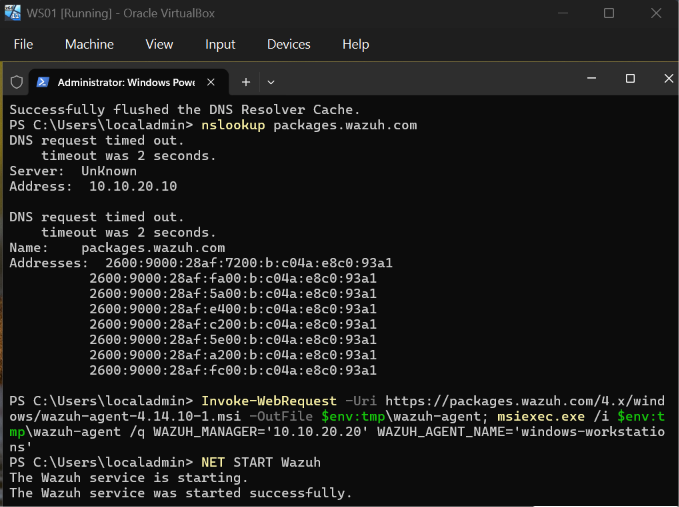
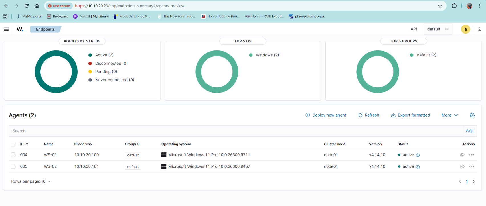
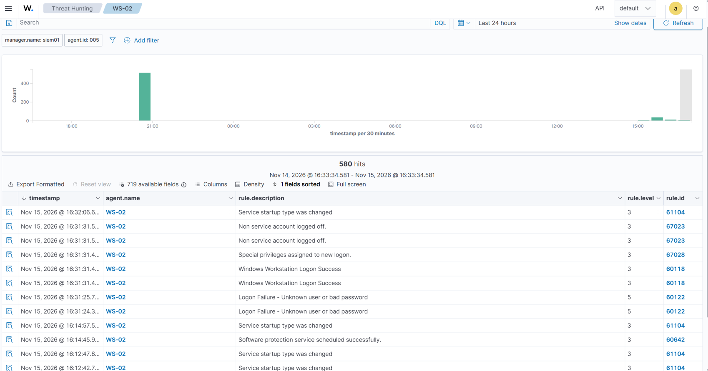

# Phase 4 — Wazuh SIEM Deployment

## What I Built

- VM: `siem01` (hostname `socadmin@siem01`), **Ubuntu Server 24.04 LTS** — single NIC on `intnet-servers`.
- Static IP `10.10.20.20/24` on `enp0s3`, gateway `10.10.20.1` (pfSense SERVERS interface).
- Confirmed connectivity before attempting install: pinged the gateway and an external host.
- Wazuh 4.14 all-in-one stack (Manager · Indexer · Dashboard) installed and running.
- Agents enrolled and **Active**: both Windows 11 workstations (WS01, WS02).


*Static IP configuration on the SIEM VM — `enp0s3` set to `10.10.20.20/24`.*


*Connectivity check — 0% packet loss to both the SERVERS gateway and an external host, confirming the VM is routed correctly before starting the install.*

## Wazuh Install

First attempt used the all-in-one installer script:

```
curl -sO https://packages.wazuh.com/4.14/wazuh-install.sh && sudo bash ./wazuh-install.sh -a
```

This failed immediately — the VM's original allocation (below the 4 GB RAM / 2 CPU minimum Wazuh requires for a single-node all-in-one deployment) wasn't enough:


*First install attempt — failed the installer's built-in hardware check.*

After bumping the VM's RAM/CPU allocation to meet the minimum, the second attempt proceeded past the hardware check — dependencies installing, the Wazuh repository added, and certificates generated for the indexer, Filebeat, and dashboard components:


*Second install attempt — past the hardware check, generating certs and installing the Wazuh indexer.*

The installer finished with all three components (indexer, Filebeat, dashboard) up, and the
dashboard reachable at `https://10.10.20.20` (self-signed cert).

> **Credentials note:** the installer prints the generated `admin` password and writes
> all cluster credentials to `wazuh-install-files.tar` on the server. These are **secrets** —
> keep that archive off GitHub and store the passwords in a password manager. Do not commit
> any screenshot or file that shows them.

## Agent Enrollment

Agents are installed on each endpoint and registered to the manager at `10.10.20.20`.
On the Windows clients, the agent MSI is pulled from the Wazuh package repo and installed
with the manager IP and an agent name, then the service is started:

```powershell
Invoke-WebRequest -Uri https://packages.wazuh.com/4.x/windows/wazuh-agent-4.14.10-1.msi -OutFile $env:tmp\wazuh-agent
msiexec.exe /i $env:tmp\wazuh-agent /q WAZUH_MANAGER='10.10.20.20' WAZUH_AGENT_NAME='windows-workstation'
NET START Wazuh
```


*WS01 — agent MSI installed against the manager and the Wazuh service started successfully.*

### Agents Active on the Dashboard

Both workstations report in as **Active**. The Endpoints summary shows the two Windows 11
clients enrolled on manager node `node01`, running agent `v4.14.10`:


*Endpoints view — WS-01 (`10.10.30.100`) and WS-02 (`10.10.30.101`) both Active.*

## Telemetry Landing

The audit policy configured in [Phase 2](02-active-directory.md) (logon, account logon,
object access, privilege use) is now producing events in Wazuh. Threat Hunting on WS-02
shows Windows logon successes and failures, privilege assignment, and service-change events,
with Wazuh rule IDs and severity levels attached:


*WS-02 events in Wazuh — logon success/failure (rule 60118 / 60122) and privilege-use events confirm the Phase 2 audit policy is reaching the SIEM.*

## Status / Next Steps

- [x] SIEM VM built, addressed, and connectivity verified.
- [x] Wazuh 4.14 all-in-one stack installed; dashboard reachable.
- [x] Agents enrolled and Active: both workstations (WS01, WS02) reporting.
- [x] Phase 2 audit events confirmed landing in Wazuh.
- [ ] Enroll `DC01` as a monitored agent (not yet enrolled — dashboard currently shows the two workstation agents only).
- [ ] Deploy Sysmon (SwiftOnSecurity config) to enrich process/network telemetry — planned via GPO in [Phase 7](07-automation.md).
- [ ] Baseline/tune rules ahead of the Phase 6 pen-test exercise.
