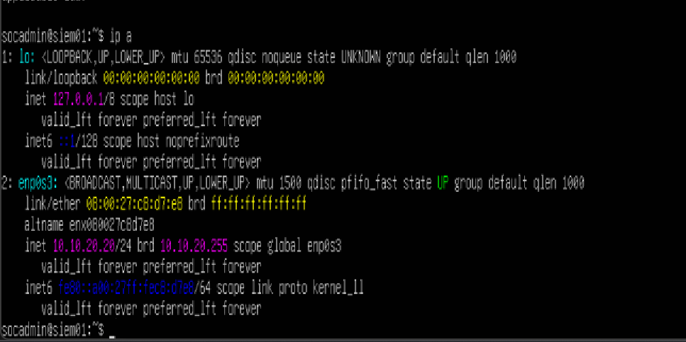
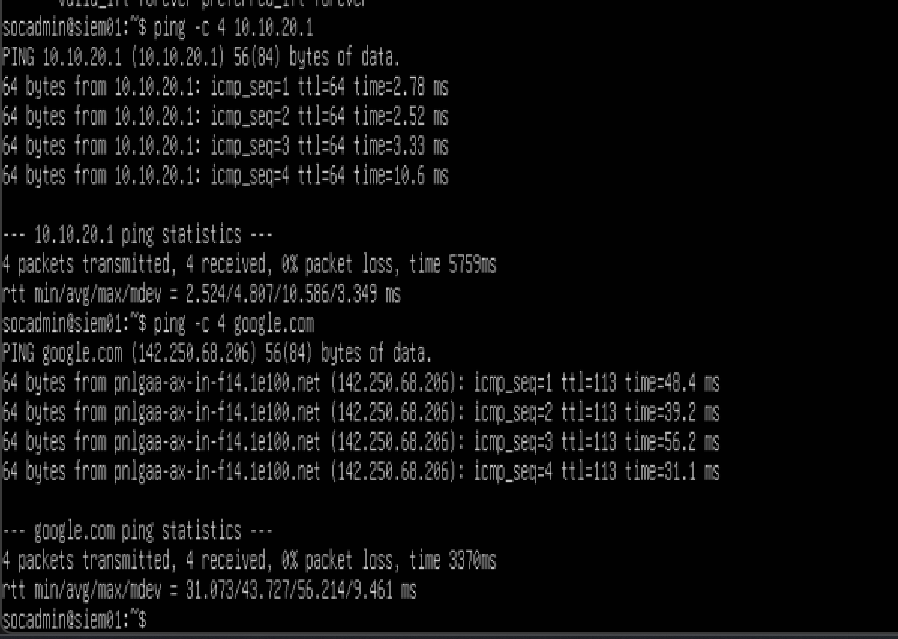
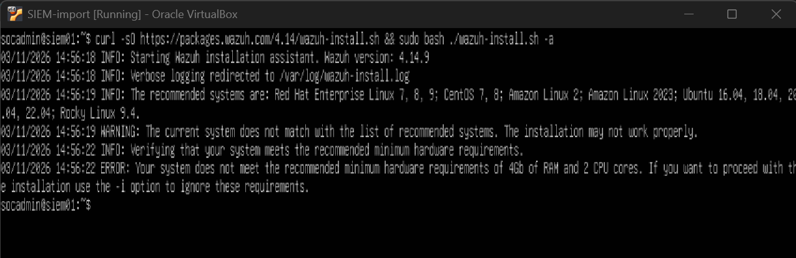
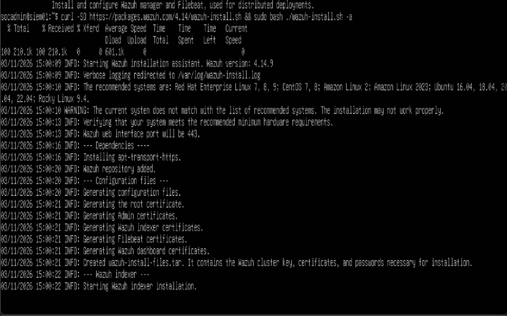

# Phase 4 — Wazuh SIEM Deployment (in progress)

## What I Built (so far)

- VM: `siem01` (hostname `socadmin@siem01`) — single NIC on `intnet-servers`.
- Static IP `10.10.20.20/24` on `enp0s3`, gateway `10.10.20.1` (pfSense SERVERS interface).
- Confirmed connectivity before attempting install: pinged the gateway and an external host.


*Static IP configuration on the SIEM VM — `enp0s3` set to `10.10.20.20/24`.*


*Connectivity check — 0% packet loss to both the SERVERS gateway and an external host, confirming the VM is routed correctly before starting the install.*

## Wazuh Install

First attempt used the all-in-one installer script:

```
curl -sO https://packages.wazuh.com/4.14/wazuh-install.sh && sudo bash ./wazuh-install.sh -a
```

This failed immediately — the VM's original allocation (below the 4 GB RAM / 2 CPU minimum Wazuh requires for a single-node all-in-one deployment) wasn't enough:


*First install attempt — failed the installer's built-in hardware check.*

After bumping the VM's RAM/CPU allocation to meet the minimum, the second attempt is proceeding past the hardware check — dependencies installing, the Wazuh repository added, and certificates being generated for the indexer, Filebeat, and dashboard components:


*Second install attempt — past the hardware check, generating certs and installing the Wazuh indexer.*

## Status / Next Steps

- Install is in progress — indexer, Filebeat, and dashboard components still need to finish and be verified.
- Once the all-in-one stack is up, next steps are: confirm dashboard access, enroll `DC01` as a monitored agent, and validate that the audit events configured in [Phase 2](02-active-directory.md) (logon, account logon, object access, privilege use) are actually landing in Wazuh.
- The two lab workstations are not domain-joined yet, so agent enrollment for `WS01`/`WS02` and the `03-workstations.md` notes come after that's done.

*(Caption: a failed login on a client next to the matching event appearing in Wazuh seconds later.)*
